# RoCo

This is a rowing (and later industrial surveying) telemetry computer and 5mm precision GPS that I designed for my first company, Precision Metrics. I taught myself hardware and made this as my first ever project in July of 2025, approximately. It worked first try, with one minor solder job :)

This repository is a monolith assembled by Claude to demonstrate my work. Most everything here besides its present organization was created by hand. This was my first engineering project; you can see the improvement between the daughterboard (my first PCB) and the mainboard (my second). 

For the boards, I used KiCad; for the enclosure, FreeCAD; and for the firmware, nothing but Rust, cross-compiled for the Pi. I recommend looking at the schematics and layout of the PCB.

A thank you to Phil's Lab and all the lovely YouTube tutorials which RL'd my brain.

All text and images henceforth are written and compiled by Claude to demonstrate the technical work I did.

<p align="center">
  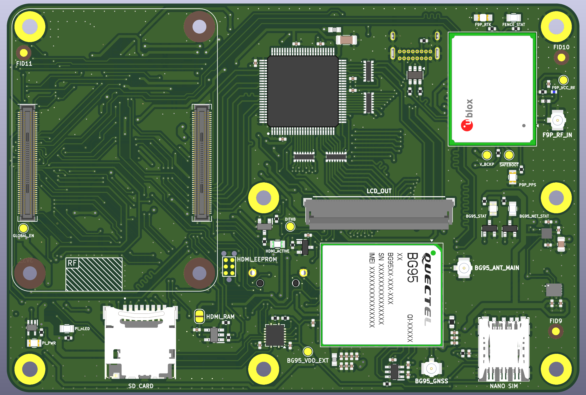
</p>

RoCo is a rowing telemetry computer. It is built around a Raspberry Pi Compute Module 4 with a u-blox ZED-F9P RTK GNSS receiver (L1/L5), a Quectel BG95 LTE-M modem, a 5-inch 800×480 display, an IMU and magnetometer, haptic feedback, and a Li-ion battery that charges over USB-C or Qi. The dashboard mockups show split per 500 m, stroke rate, distance per stroke, check, and session totals. I designed it in 2025–26 at Precision Metrics, my hardware startup.

This repository holds the four KiCad boards, the FreeCAD enclosure, and the Rust firmware that runs on the CM4. The boards carry the internal name RowCore: MB1 is the mainboard, DB1 the power board.

## System

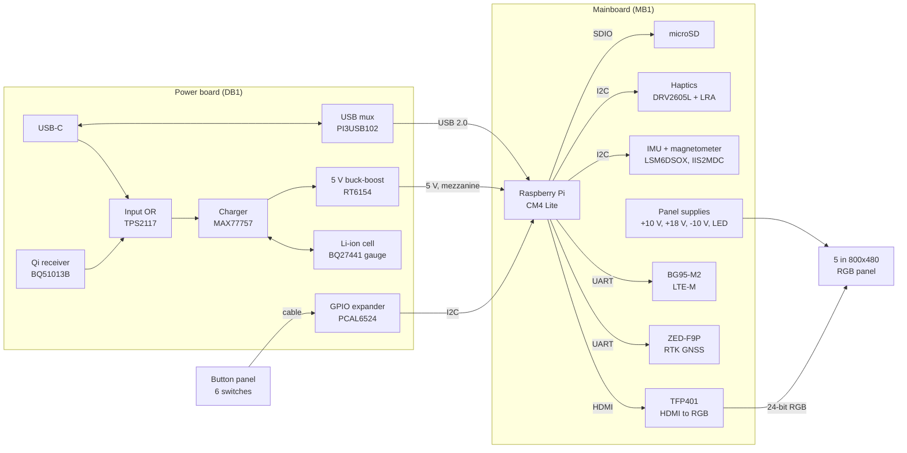

The mainboard and power board stack on a 20-pin Samtec LSHM mezzanine that carries 5 V, 3.3 V, USB, I²C, I²S, and interrupt lines. The button panel is wired to the power board's switch inputs, with Molex Pico-Lock connectors on both boards.

## Boards

Numbers come from `kicad-cli pcb export stats` on the files in this repository.

| Board | Folder | Copper layers | Size | Footprints | Vias |
|---|---|---|---|---|---|
| Mainboard (MB1, v0.1.0) | [`hardware/mainboard`](hardware/mainboard) | 4 | 111.5 × 75.7 mm | 229 (112 top, 117 bottom) | 1,013 |
| Power board (DB1, v0.2.0) | [`hardware/power-board`](hardware/power-board) | 4 | 66.0 × 42.35 mm | 109 (all top) | 290 |
| Button panel (v0.1.0) | [`hardware/button-panel`](hardware/button-panel) | 2 | 55.0 × 17.0 mm | 17 (13 top, 4 bottom) | 6 |
| U.FL adapter | [`hardware/ufl-adapter`](hardware/ufl-adapter) | 2 | 10.0 × 13.5 mm | 2 | 12 |

- **Mainboard.** CM4 Lite carrier on two Hirose DF40 board-to-board connectors. It holds the ZED-F9P with active-antenna bias and its own low-noise LDOs, a backup cell, and a debug USB-C port. Next to it are the BG95-M2 with a nano-SIM and a 1.8 V to 3.3 V level shifter, and a TFP401 HDMI receiver driving the panel's RGB interface. Display power comes from an MP3308 backlight driver, two LMR62014 boosts (+10 V AVDD, +18 V VGH) and an ICL7660 charge pump (−10 V VGL). The board also carries 3.3 V and 3.6 V bucks, microSD, the LSM6DSOX IMU, the IIS2MDC magnetometer, and a DRV2605L haptic driver.
- **Power board.** USB-C and a Qi receiver (BQ51013B) are ORed by a TPS2117 into a MAX77757 charger, with a BQ27441 fuel gauge and reverse-polarity protection on the cell. An RT6154 buck-boost makes the 5 V system rail, and an STM6601 push-button controller handles power on and off. A PI3USB102 switches the USB-C data lines between charger negotiation and the CM4. A PCAL6524 I²C expander reads the buttons and drives the enables.
- **Button panel.** Six Panasonic EVQ-Q2U03W switches on a 55 mm strip. The enclosure has a matching TPU button cover.
- **U.FL adapter.** A short grounded coplanar trace with a via fence between a TE Connectivity CONMHF1 receptacle and a Hirose U.FL.

## Design highlights

- **HDMI to RGB.** The CM4's HDMI0 output feeds a TI TFP401 DVI receiver, which drives the panel's 24-bit RGB bus through 33 Ω series-termination arrays. A 24LC02 EEPROM on the DDC lines supplies EDID and can be programmed in production through a TC2030 footprint.
- **Controlled impedance.** Five differential pairs need it: four 100 Ω HDMI TMDS pairs on L1 over the L2 plane, and the 90 Ω USB 2.0 pair on L4 over L3. Three RF feeds use 50 Ω coplanar waveguide: the ZED-F9P antenna input and the BG95's main and GNSS antennas. The trace geometry, the fab stackup and the impedance spec sent with the gerbers are [below](#stackup-and-impedance-control).
- **Length tuning.** KiCad tuning meanders even out lengths on the ZED-F9P USB pair, one HDMI TMDS lane, and parts of the RGB bus.
- **Double-sided assembly.** The mainboard has 112 footprints on top and 117 on the bottom, routed at 0.15 mm track and space with 0.2 mm drilled vias. In1 is a solid ground plane under the L1 signals, and In2 carries ground, 5 V and the display supplies.

## Gallery

### Board renders

<table>
  <tr>
    <td align="center"><a href="hardware/docs/images/render-mainboard-front.png"></a><br>Mainboard, top</td>
    <td align="center"><a href="hardware/docs/images/render-mainboard-back.png">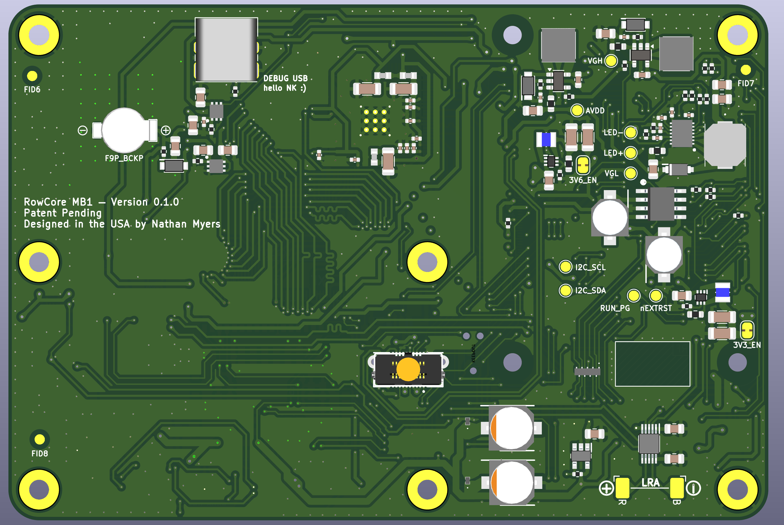</a><br>Mainboard, bottom</td>
  </tr>
  <tr>
    <td align="center"><a href="hardware/docs/images/render-power-board-top.png">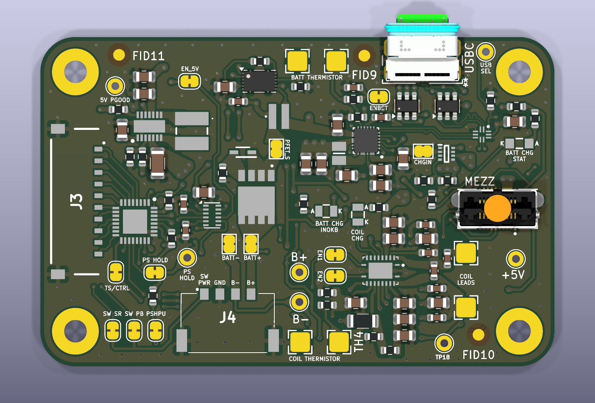</a><br>Power board, top</td>
    <td align="center"><a href="hardware/docs/images/render-power-board-bottom.png">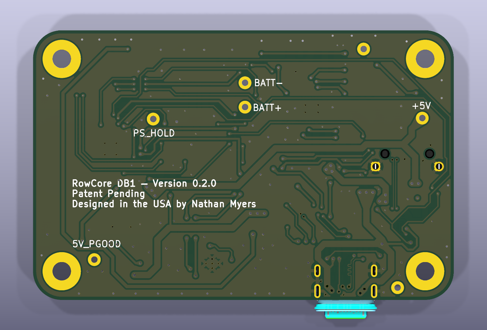</a><br>Power board, bottom</td>
  </tr>
  <tr>
    <td align="center" colspan="2"><a href="hardware/docs/images/render-button-panel-top.png">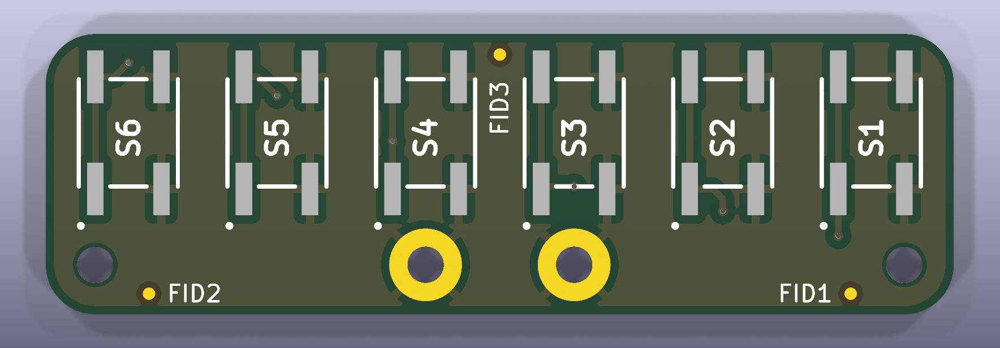</a><br>Button panel, top</td>
  </tr>
</table>

The mainboard renders went to the fab with the gerbers; the power board and button panel renders show bare pads wherever a third-party 3D model is not in this repository.

### Enclosure

<p align="center">
  <a href="hardware/docs/images/render-enclosure-proto2.png">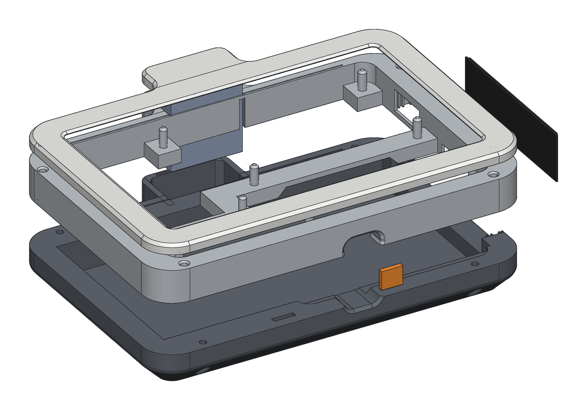</a>
</p>

Case prototype 2 ([`RoCo_case_prototype_2.FCStd`](hardware/enclosure/RoCo_case_prototype_2.FCStd)), with the parts in their model positions, display side up: the shell at the bottom, the PCB bracket, the display bracket on top, and the TPU cover for the button panel to the right. The 3MF print exports are in [`hardware/enclosure`](hardware/enclosure).

### Schematics

<table>
  <tr>
    <td align="center"><a href="hardware/docs/images/schematic-mainboard-top.png">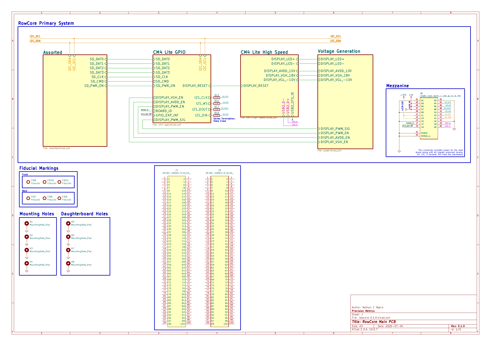</a><br>Mainboard: root sheet and mezzanine</td>
    <td align="center"><a href="hardware/docs/images/schematic-mainboard-cm4-high-speed.png">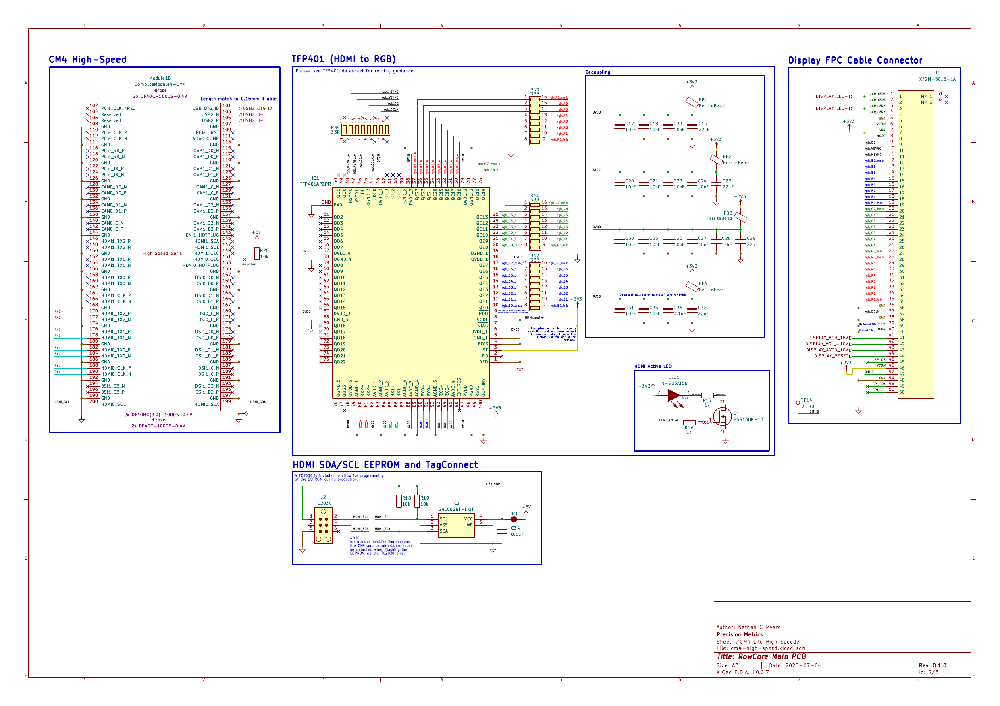</a><br>Mainboard: CM4 high-speed, TFP401, display FPC</td>
  </tr>
  <tr>
    <td align="center"><a href="hardware/docs/images/schematic-mainboard-cm4-gpio.png">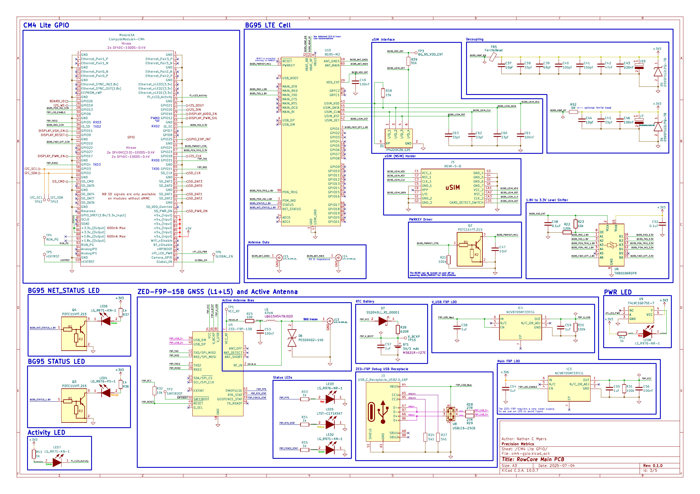</a><br>Mainboard: CM4 GPIO, BG95, ZED-F9P</td>
    <td align="center"><a href="hardware/docs/images/schematic-mainboard-power.png">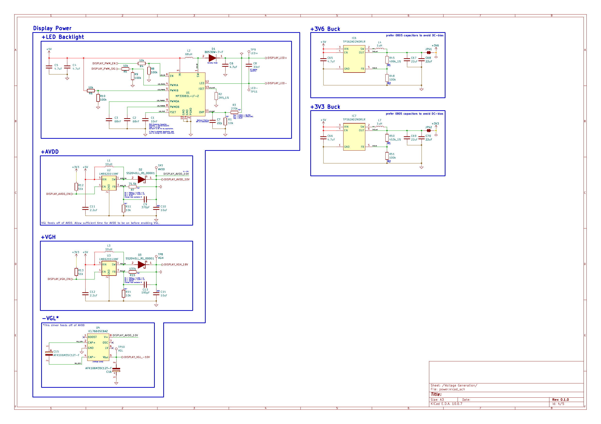</a><br>Mainboard: display supplies, 3V3 and 3V6 bucks</td>
  </tr>
  <tr>
    <td align="center"><a href="hardware/docs/images/schematic-mainboard-assorted.png">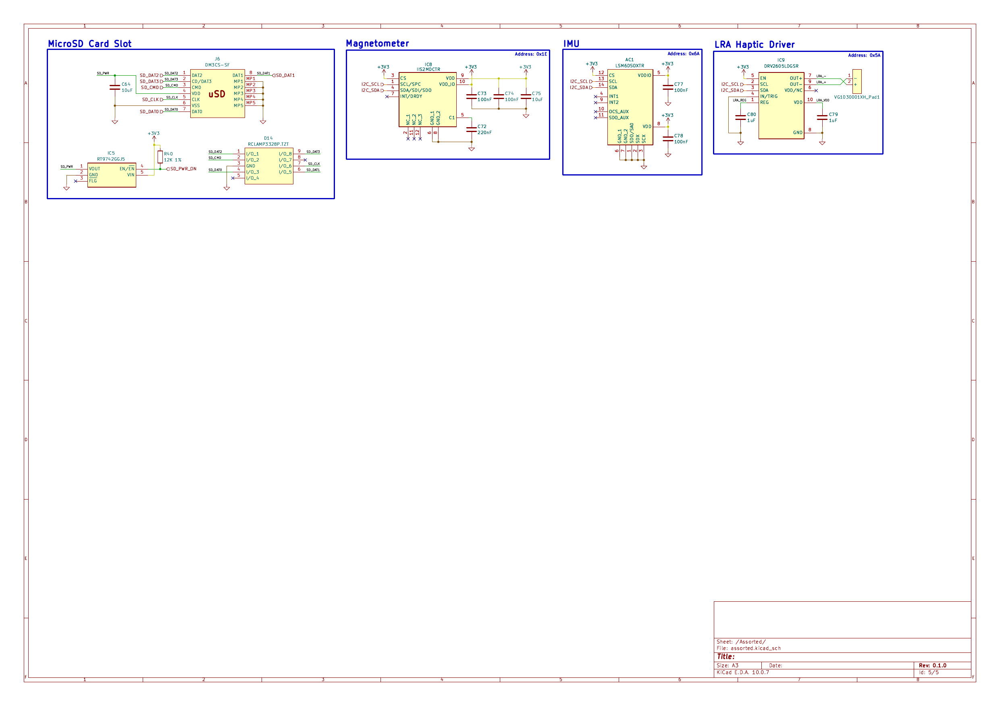</a><br>Mainboard: microSD, IMU, magnetometer, haptics</td>
    <td align="center"><a href="hardware/docs/images/schematic-power-board.png">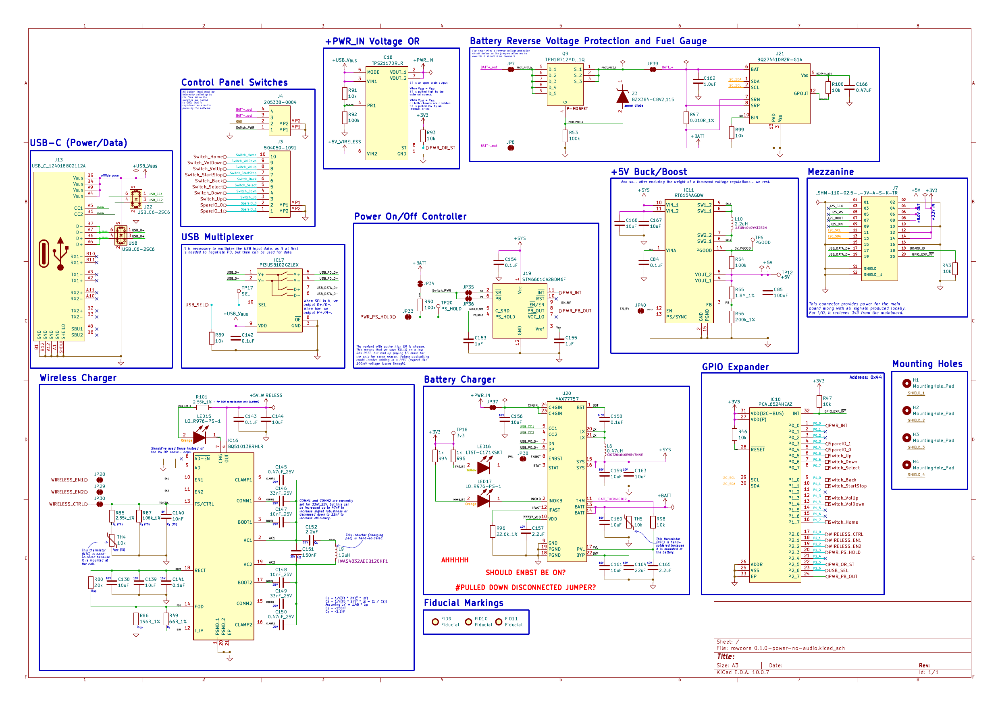</a><br>Power board (single sheet)</td>
  </tr>
</table>

Click a thumbnail for the full sheet (A3 at 150 dpi). The KiCad sources are [`hardware/mainboard/rowcore 0.1.0.kicad_sch`](hardware/mainboard/rowcore%200.1.0.kicad_sch) and [`hardware/power-board/rowcore 0.1.0-power-no-audio.kicad_sch`](hardware/power-board/rowcore%200.1.0-power-no-audio.kicad_sch).

### Stackup and impedance control

<p align="center">
  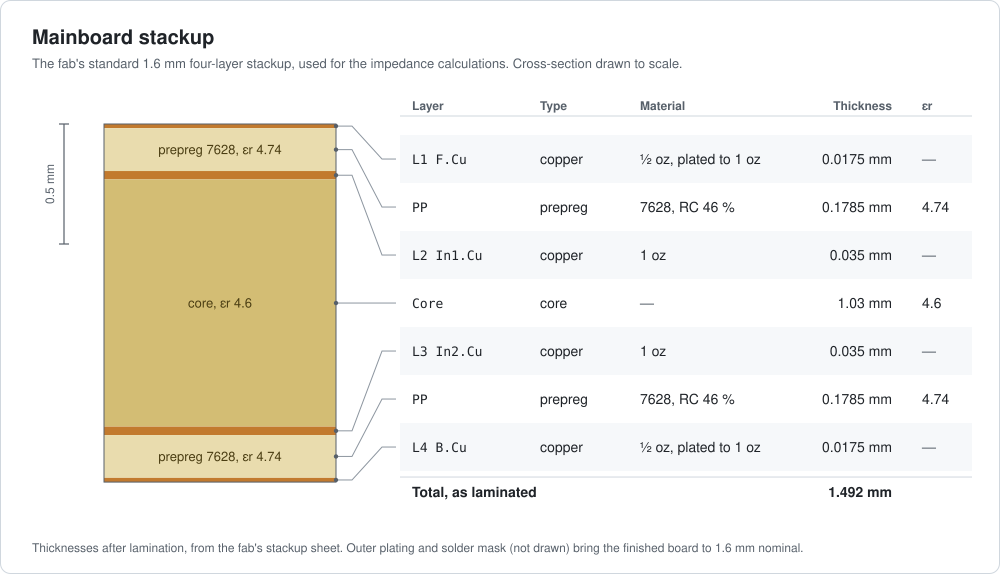
</p>

This is the fab's standard 1.6 mm four-layer stackup, used for the impedance calculations: 0.1785 mm of 7628 prepreg (εr 4.74) on each side of a 1.03 mm core (εr 4.6), 1 oz inner copper, and ½ oz outer copper plated to 1 oz. The fab's stackup sheet is in [`_stackup.pdf`](hardware/mainboard/Manufacturing/_stackup.pdf) (also as a [PNG](hardware/docs/images/stackup-fab.png)).

Trace geometry was set with the fab's impedance calculator against that stackup ([`Impedence Control.csv`](hardware/mainboard/Manufacturing/Impedence%20Control.csv)):

| # | Type | Signal layer | Reference layer | Trace width (mm) | Spacing (mm) | Target impedance | Use |
|---|---|---|---|---|---|---|---|
| 1 | Differential | L4 | L3 | 0.277 | 0.2917 | 90 Ω ± 10 % differential, 45 Ω ± 10 % single-ended | USB 2.0 |
| 2 | Differential | L1 | L2 | 0.272 | 0.7 | 100 Ω ± 5 % differential, 50 Ω ± 10 % single-ended | HDMI |
| 3 | Coplanar waveguide | L1 | L2 | 0.377396 | — | 50 Ω ± 10 % | RF |

The impedance spec that went out with the gerbers ([PDF](hardware/mainboard/Manufacturing/rowcore_gerbers/Impedence%20Control%20Specifics.pdf)) marks each controlled trace on the layout: the USB 2.0 pair, the four HDMI pairs and the three RF feeds.

### Mainboard copper

Each copper layer plotted with the board outline, seen from the top.

<table>
  <tr>
    <td align="center"><a href="hardware/docs/images/copper-mainboard-F_Cu.png">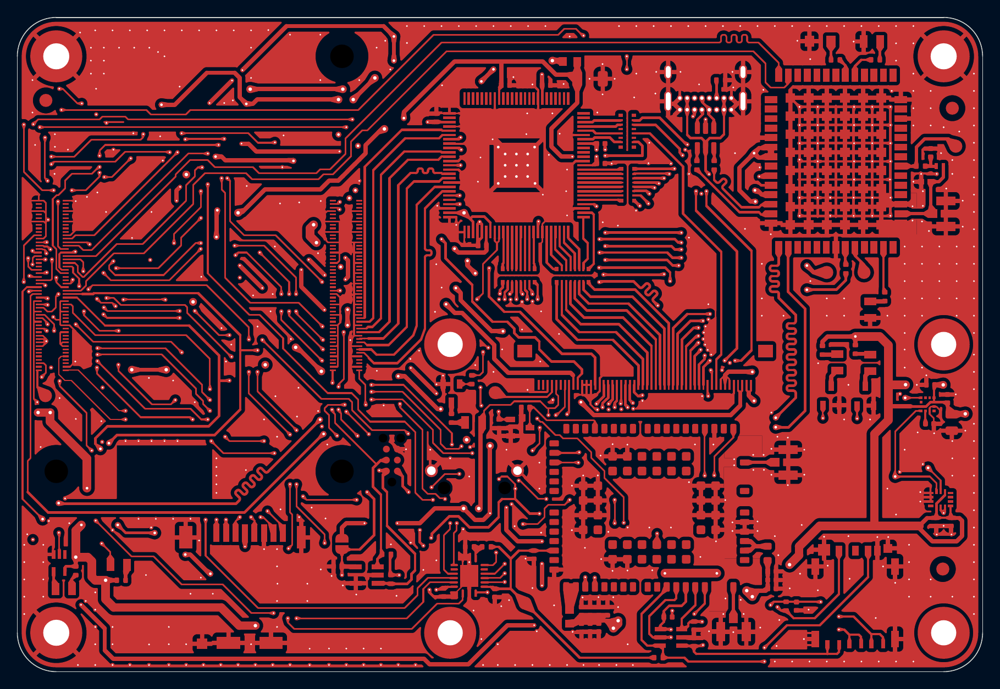</a><br>L1 · F.Cu</td>
    <td align="center"><a href="hardware/docs/images/copper-mainboard-In1_Cu.png">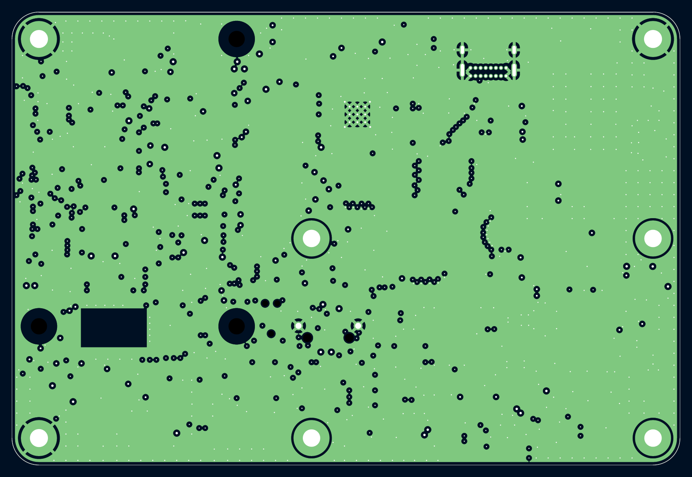</a><br>L2 · In1.Cu (solid ground plane)</td>
  </tr>
  <tr>
    <td align="center"><a href="hardware/docs/images/copper-mainboard-In2_Cu.png">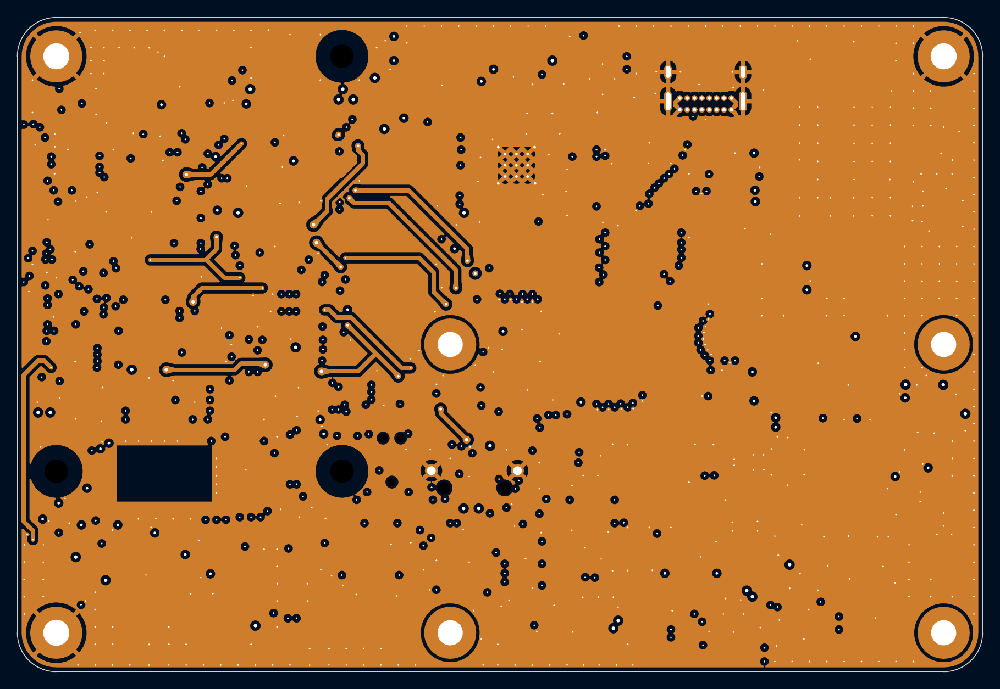</a><br>L3 · In2.Cu (ground, 5 V and display supplies)</td>
    <td align="center"><a href="hardware/docs/images/copper-mainboard-B_Cu.png">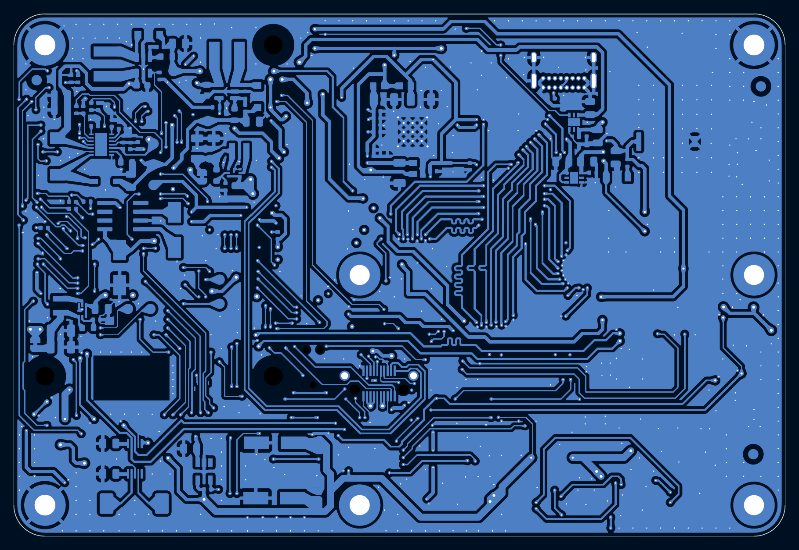</a><br>L4 · B.Cu</td>
  </tr>
</table>

## Firmware

[`firmware/`](firmware) is a single Rust crate (edition 2024, about 6,700 lines) for Raspberry Pi OS on the CM4. It runs on a single-threaded Tokio runtime, since the work is I/O-bound.

| Module | Lines | What it does |
|---|---|---|
| [`src/io/ubx.rs`](firmware/src/io/ubx.rs) | 2,706 | UBX protocol: framing, Fletcher-8 checksums, and typed decoders for NAV-PVT, NAV-HPPOSLLH, NAV-RELPOSNED, NAV-SIG, NAV-SAT, NAV-DOP, NAV-SVIN, MON-RF, SEC-SIG, RXM-RTCM and ACK, plus CFG-VALGET/VALSET request builders and a VALGET decoder. `UBXHub` is the async hub: one task owns the serial read half, parses frames and publishes each (class, id) on its own `watch` channel, and a second task owns the write half. `request()` registers a waiter, tagged with a per-route sequence number, before sending, so a reply that arrives immediately is not lost. |
| [`src/io/gps.rs`](firmware/src/io/gps.rs) | 477 | Opens `/dev/serial0` at the receiver's default 38,400 baud and moves UART1 to 230,400 with CFG-VALSET. It then starts the hub, a poll scheduler with a separate interval per message, and an aggregator that publishes a `GNSSFix` snapshot once a second. |
| [`src/io/debug_gnss.rs`](firmware/src/io/debug_gnss.rs) | 184 | RF health summary: C/N0 statistics, AGC level and the CW jamming indicator. |
| [`src/graphics/display.rs`](firmware/src/graphics/display.rs) | 365 | DRM/KMS renderer. It picks a connected connector (HDMI first, since the panel sits behind the TFP401), maps two XRGB8888 dumb buffers, and page-flips on vblank. The flip event is awaited through `AsyncFd`, so rendering never blocks the runtime. |
| [`src/graphics/text.rs`](firmware/src/graphics/text.rs) | 845 | Glyph atlas: rasterizes a TTF embedded at compile time with `ab_glyph` and caches the atlas on disk, validated by FNV-1a hashes of the font and charset. Glyphs are alpha-blended straight into the framebuffer, with multi-color spans. |
| [`src/graphics/debug_terminal.rs`](firmware/src/graphics/debug_terminal.rs) | 254 | `tracing` to framebuffer console. A `tracing_subscriber` layer forwards every event to an on-screen terminal, colored by level and by target, alongside the normal stdout formatter. |
| [`src/io/at.rs`](firmware/src/io/at.rs), [`src/io/cell.rs`](firmware/src/io/cell.rs) | 771 + 634 | BG95 AT driver: command and response types, a URC parser, and an `ATHub` that runs commands one at a time through a single reader/writer task, returning each response on a oneshot channel, plus a status poller for SIM, registration and signal quality. Untested on hardware, and `main.rs` does not start it yet. The parsers have unit tests. |
| [`src/main.rs`](firmware/src/main.rs) | 102 | Brings up the display and the GNSS pipeline, then renders the debug terminal with live NAV-PVT and RF-health logs. |

The UI mockup below is a full 800×480 frame, shown rotated to the panel's portrait mounting. The first firmware commit blitted these frames to the panel to preview the dashboard; the Rust code does not draw that dashboard yet.

<p align="center">
  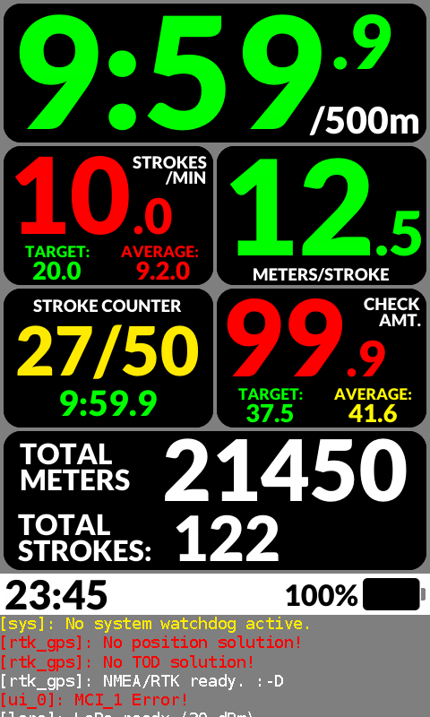
</p>

More frames: [`fudge2.png`](firmware/docs/images/fudge2.png) (split field blanked), [`fudge3.png`](firmware/docs/images/fudge3.png), [`fudge4.png`](firmware/docs/images/fudge4.png).

### Build and deploy

The [`justfile`](firmware/justfile) cross-compiles for `aarch64-unknown-linux-gnu` and deploys over SSH. Development was on Windows, so each recipe runs cargo inside WSL.

```sh
cd firmware
just check           # cargo check
just build           # cargo build --target aarch64-unknown-linux-gnu
just build-release   # release build
just deploy          # build, scp the binary and data/ to the CM4, chmod +x, open ssh
```

Without WSL, run cargo directly, e.g. `cargo build --release --target aarch64-unknown-linux-gnu`, with an aarch64 cross linker installed. `deploy` also copies a local `data/` directory, which is not in the repository, so run `mkdir data` before the first deploy (the firmware builds its glyph cache in `data/glyphs` on the CM4).

Linking uses `aarch64-linux-gnu-gcc` (see [`.cargo/config.toml`](firmware/.cargo/config.toml)). The target host and path are variables at the top of the justfile. [`roco_boot_mods.txt`](firmware/roco_boot_mods.txt) lists the Raspberry Pi OS changes: a forced 800×480 HDMI mode for the TFP401, power-on defaults for the display-enable GPIOs, and a boot splash.

## Repository layout

```
hardware/
  mainboard/      MB1 KiCad project; Manufacturing/ has gerbers, drill files, stackup, impedance spec, BOM
  power-board/    DB1 KiCad project (v0.2.0); Manufacturing/ has gerbers and drill files
  button-panel/   KiCad project; _Exports/ has fab outputs
  ufl-adapter/    KiCad project; export/ has fab outputs
  libraries/      project symbols, footprints and 3D models
  enclosure/      FreeCAD case prototypes and 3MF print exports
  docs/images/    renders, schematics, stackup and copper plots used in this README
firmware/
  src/io/         UBX, GNSS and BG95 AT drivers
  src/graphics/   DRM/KMS display, glyph atlas, debug terminal
  docs/images/    UI mockups
```

The mainboard folder also keeps three earlier sheets (`io_battery_and_power`, `daughter_no_voice`, `daughter_with_voice`) that the root schematic no longer references. The boards and schematics embed their own copies of every symbol and footprint. A few vendor-licensed library parts are left out of `hardware/libraries/`. The files are in KiCad 9 format.

## Timeline

| When | What |
|---|---|
| Jul–Sep 2025 | Schematics and layout for the mainboard and power board |
| Sep 2025 | Gerbers for both boards, plus the mainboard stackup and impedance spec, sent to PCBWay |
| Nov 2025 | Power board v0.2.0 |
| Dec 2025–Jan 2026 | FreeCAD enclosure prototypes |
| Jan 2026 | Button panel, U.FL adapter, Rust firmware |
